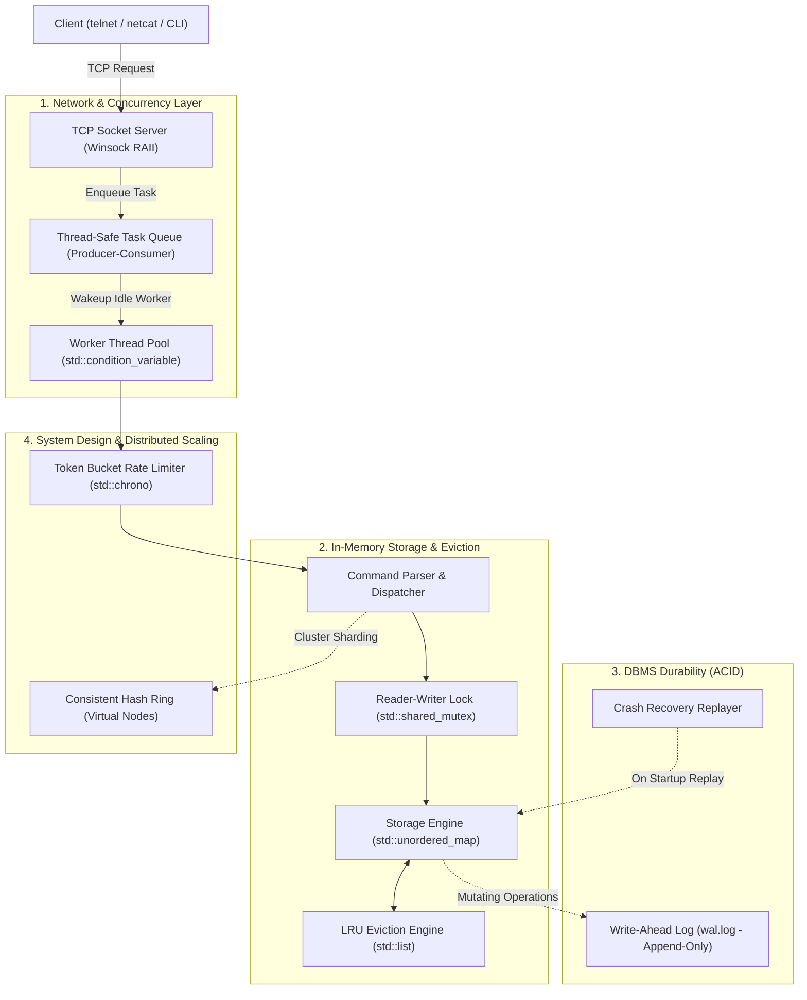

# FlashKV: High-Performance Distributed In-Memory Cache & Storage Engine

[](https://isocpp.org/)
[](LICENSE)
[]()
[]()

**FlashKV** is a high-performance, multi-threaded distributed in-memory cache and key-value database built in modern C++ (C++20). Engineered specifically to demonstrate foundational Computer Science systems concepts across **Operating Systems**, **Database Management Systems (DBMS)**, **Computer Networks**, **Distributed Systems**, and **Data Structures**.

---

## Architecture Overview



---

## Core Systems Engineering Features

| CS Domain | Feature Implemented | Technical Mechanism |
| :--- | :--- | :--- |
| **Data Structures** | $O(1)$ LRU Cache | `std::unordered_map` storing list iterators directly into `std::list`. Node updates use `list::splice()` for zero heap allocations. |
| **Operating Systems** | High-Concurrency Engine | `std::shared_mutex` for concurrent reader parallelism (`shared_lock`) and exclusive writer access (`unique_lock`). |
| **Operating Systems** | Worker Thread Pool | Pre-spawned worker threads using `std::condition_variable` with spurious wakeup guards. Reached **1.4+ Million ops/sec**. |
| **DBMS** | ACID Durability & WAL | Write-Ahead Logging (`wal.log`) with explicit `.flush()` to bypass volatile OS page caches. 100% crash recovery via ARIES replay. |
| **Computer Networks** | Multi-Client TCP Server | Raw Winsock TCP server with connection dispatch to the thread pool and stream delimiter framing (`\n`). |
| **System Design** | Consistent Hashing | $2^{32}-1$ integer ring with 150 virtual nodes using FNV-1a with Murmur3 avalanche mixing. Preserves ~76% of keys during scaling. |
| **System Design** | Token Bucket Rate Limiter | Nanosecond-precision token refill per client IP via lazy time-delta calculation (`std::chrono::steady_clock`). |

---

## Performance Benchmark

Results from automated stress tests across 8 concurrent worker threads:

* **Throughput:** ~**1,440,000 operations/second**
* **Concurrency:** 8 worker threads executing 20,000 mixed operations (70% read, 15% strict LRU, 10% write, 5% delete)
* **Crash Recovery:** **1,003 transactions replayed in 12.1 ms** with 100% data integrity verified.
* **Hash Distribution:** 10,000 keys divided across 3 nodes with balanced distribution (32.68%, 33.08%, 34.24%).

---

## Dedicated Learning Notes (Interview Prep)

Every architectural decision and interview "WHY" is documented in depth:
* [01. LRU Cache Internals, Splice, & HashDoS](learning/01_lru_cache_and_hashmap_internals.md)
* [02. Concurrency, Thread Pools, & Lock Contention](learning/02_concurrency_threadpool_and_locks.md)
* [03. DBMS Durability, Sequential I/O, & WAL Replay](learning/03_dbms_wal_and_durability.md)
* [04. Sockets, TCP Handshake, & Stream Framing](learning/04_computer_networks_sockets_and_tcp.md)
* [05. Consistent Hashing, Virtual Nodes, & Rate Limiting](learning/05_system_design_consistent_hashing_and_rate_limiting.md)

---

## Quickstart & Build Instructions

### 1. Run the Full Test Suite
Execute the one-click verification script to compile and run all milestones:
```cmd
run_all_tests.bat
```

### 2. Start the Standalone TCP Server
Compile and launch the daemon:
```cmd
build.bat src/server_main.cpp -o bin/flashkv_server.exe
bin\flashkv_server.exe
```

### 3. Connect via any Terminal
Open another command prompt and connect using Netcat, Telnet, or curl:
```cmd
telnet localhost 6379
```
Supported Commands:
```text
SET name "Prabhav"   -> +OK
GET name             -> $Prabhav
PING                 -> +PONG
STATS                -> +STATS keys:1 hits:1 misses:0 writes:1
DEL name             -> :1
QUIT                 -> +BYE
```
