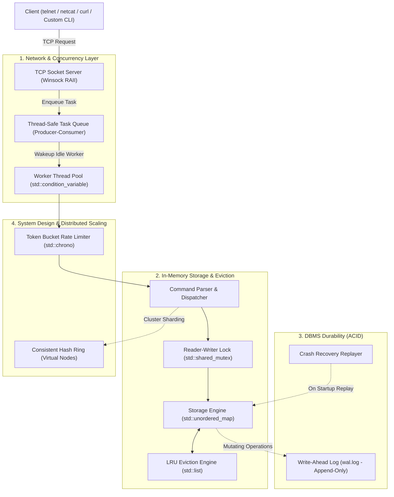

# FlashKV: High-Performance Distributed In-Memory Cache & Storage Engine

Welcome to the technical design document for **FlashKV**. This document acts as your placement handbook, architectural blueprint, and interview defense manual.

---

## 1. System Architecture Diagram

---

## 2. Core CS Fundamentals Mapping

Every technical decision in FlashKV maps directly to core computer science concepts expected in tier-1 SDE placement interviews:

| CS Domain | Concept Implemented | Exact Real-World Mechanism | Why It Matters in Interviews |
| :--- | :--- | :--- | :--- |
| **Operating Systems** | Reader-Writer Locking | `std::shared_mutex` allows concurrent reads (`std::shared_lock`) and exclusive writes (`std::unique_lock`). | Solves lock contention. In a 90% read workload, standard mutexes serialize traffic and choke throughput. |
| **Operating Systems** | Thread Pool & Synchronization | Fixed pool of $N$ threads waiting on a `std::condition_variable` with a mutex-protected task queue. | Avoids thread-creation overhead ($O(\text{context switch})$) and OS kernel thread exhaustion under traffic spikes. |
| **Data Structures** | $O(1)$ LRU Cache | Hash Map storing iterators directly into a Doubly Linked List. | $O(1)$ lookup, $O(1)$ eviction, and $O(1)$ update to MRU (Most Recently Used) position without searching. |
| **DBMS** | Write-Ahead Logging (WAL) | Sequential disk writes (`std::ofstream`) with explicit `.flush()` before modifying RAM. | Guarantees **Durability** (the 'D' in ACID). Enables zero data loss on abrupt process termination or power cuts. |
| **Computer Networks** | TCP Sockets & Framing | Winsock TCP server, non-blocking/blocking worker loop, command demarcation (`\r\n`). | Explains socket lifecycle: `socket() -> bind() -> listen() -> accept() -> recv() / send() -> close()`. |
| **System Design** | Consistent Hashing | $2^{32}-1$ integer ring with virtual nodes (`std::map::lower_bound`). | Replaces naive modulo sharding ($K \pmod N$), minimizing key migration when nodes join or fail to only $K/N$ keys. |
| **System Design** | Token Bucket Rate Limiter | Replenishing token bucket based on elapsed time (`std::chrono::steady_clock`). | Allows burst tolerance up to capacity while enforcing a strict sustained rate limit per IP. |

---

## 3. C++ Modern Best Practices Checklist

We strictly adhere to standard, industry-grade C++ without obsolete idioms or unnecessary third-party dependencies:

1. **RAII (Resource Acquisition Is Initialization):**
   - Sockets are automatically closed in destructors.
   - File descriptors and locks (`std::unique_lock`, `std::shared_lock`) automatically release when leaving scope.
2. **Rule of 5:**
   - Classes managing resources properly declare or delete destructor, copy constructor, copy assignment, move constructor, and move assignment.
3. **Smart Pointers & Ownership:**
   - Prefer `std::unique_ptr` for exclusive ownership (e.g. Server, Worker, Node instances).
   - Zero raw `new` and `delete` statements in application logic.
4. **Move Semantics (`std::move`):**
   - Passing large strings and buffers by value and moving them to eliminate unnecessary heap copies.
5. **Zero-Copy Parsing:**
   - Using `std::string_view` for parsing command arguments without copying substrings.

---

## 4. Placement Interview Defense Cheat-Sheet (Top 5 Questions)

### Q1: Why use `std::shared_mutex` instead of a regular `std::mutex`?
> **Answer:** In typical database workloads (like Redis or Memcached), reads outnumber writes by 9:1 or more. A standard `std::mutex` blocks all threads even when they only want to read. `std::shared_mutex` allows hundreds of threads to read concurrently via `std::shared_lock`. Only when a mutation (`SET`, `DEL`) occurs does a thread acquire an exclusive `std::unique_lock`, maximizing read throughput.

### Q2: How does the LRU Cache achieve true $O(1)$ operations?
> **Answer:** A naive list has $O(N)$ lookup. A naive hash map has no order. By storing an `std::list<Entry>::iterator` as the value inside `std::unordered_map`, we get $O(1)$ hash lookup to find the node, and we can immediately splice/move that node to the head of the `std::list` in $O(1)$ pointer operations. When evicting, the tail of the list is popped in $O(1)$, and its key is removed from the map in $O(1)$.

### Q3: What is the Write-Ahead Logging (WAL) protocol and how does it guarantee durability?
> **Answer:** The fundamental rule of WAL is: *no data page or in-memory state is updated until the corresponding log record is flushed to persistent storage*. On crash, the database reads the WAL from start to finish, sequentially executing every command to rebuild the exact memory state prior to the crash.

### Q4: Why is Consistent Hashing preferred over Modulo Hashing ($H(key) \pmod N$)?
> **Answer:** In simple modulo hashing, if the number of server nodes $N$ changes (due to a server crash or scale-up), almost 100% of keys map to new nodes, causing a massive cache stampede and overloading the database. Consistent hashing arranges nodes on a ring ($0$ to $2^{32}-1$). Adding or removing a node only redistributes keys between adjacent nodes ($\approx 1/N$ of keys). Virtual nodes ensure even load distribution across physical machines.

### Q5: How do you prevent spurious wakeups in a Thread Pool?
> **Answer:** When a thread waits on a condition variable (`cv.wait(lock, predicate)`), the OS kernel may occasionally wake it up even without a signal (spurious wakeup). We always pass a predicate (or wrap the wait inside `while (tasks.empty())`) so the thread verifies the queue is genuinely non-empty before proceeding.
